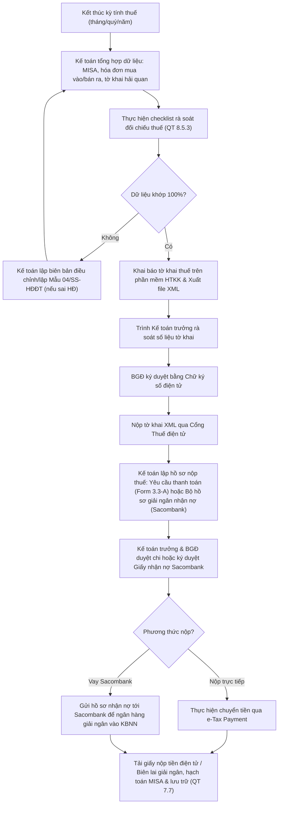

# 8.5 Quản lý Thuế

## 1. Mục đích
- Kê khai, nộp thuế đúng hạn, đúng quy định — tránh phạt và rủi ro pháp lý.

## 2. Các loại Thuế Liên quan

| Thuế | Thuế suất | Kỳ kê khai | Hạn nộp | Áp dụng / Lưu ý |
|------|----------|-----------|--------|---------|
| **Thuế NK** | 0-50% | Mỗi lô NK | Khi thông quan | Tính trên giá CIF. Miễn/giảm theo FTA (EVFTA: lộ trình về 0%). |
| **Thuế TTĐB (Nhập khẩu)** | 35-65% | Mỗi lô NK | Khi thông quan | Tính trên (Giá CIF + Thuế NK). Xem chi tiết lộ trình tăng thuế dưới đây. |
| **Thuế TTĐB (Nội địa)** | 35-65% | Hàng tháng | Ngày 20 tháng sau | Tính trên giá bán nội địa (chưa VAT & TTĐB). Được khấu trừ số đã nộp khâu NK. |
| **Thuế GTGT (Khâu NK)** | 10% / 8% | Mỗi lô NK | Khi thông quan | 10% đối với rượu có cồn; **8% đối với rượu không cồn** (theo diện giảm thuế VAT). |
| **Thuế GTGT (Bán ra)** | 10% / 8% | Hàng tháng/quý | Ngày 20 tháng sau / Ngày 30 tháng đầu quý sau | 10% đối với rượu thường; **8% đối với sản phẩm không cồn** (rượu không cồn). |
| **Thuế TNDN** | 20% | Hàng quý (tạm) + Năm (quyết toán) | Ngày 30 tháng sau quý / Ngày 31/03 năm sau | Tính trên lợi nhuận chịu thuế của doanh nghiệp. |
| **Thuế TNCN** | 5-35% | Hàng tháng/quý | Ngày 20 tháng sau / Ngày 30 tháng đầu quý sau | Tính trên thu nhập từ tiền lương, tiền công của CBCNV. |
| **Lệ phí môn bài** | 1-3tr VND | Hàng năm | Ngày 30/01 hàng năm | Theo vốn điều lệ (dưới 10 tỷ: 2tr/năm, từ 10 tỷ trở lên: 3tr/năm). |
| **Thuế nhà thầu (FCT)** | Theo dịch vụ | Từng lần thanh toán / Hàng tháng | 10 ngày sau khi thanh toán / Ngày 20 tháng sau | Áp dụng khi trả tiền dịch vụ cho nước ngoài (Facebook/Google Ads, Logistics ngoại...). |

*Lộ trình tăng thuế suất TTĐB đối với sản phẩm Rượu dưới 20 độ:*
- **Từ 01/01/2026:** 35%
- **Từ 01/01/2027:** 40%
- **Từ 01/01/2028:** 45%
- **Từ 01/01/2029:** 50%
- **Từ 01/01/2030:** 55%
- **Từ 01/01/2031:** 60%

*Lưu ý: Đối với **rượu không cồn** (nồng độ cồn < 0.5% hoặc = 0%), sản phẩm **không thuộc đối tượng chịu thuế TTĐB** (TTĐB = 0%) và được áp dụng mức thuế suất GTGT ưu đãi **8%**.*

## 3. Lịch Kê khai & Nộp Thuế

| Kỳ kê khai | Loại thuế / Báo cáo | Lập & rà soát tờ khai (R) | Hạn nộp tờ khai & nộp thuế (D) | Đối tượng áp dụng / Ghi chú |
|:---|:---|:---|:---|:---|
| **Hàng tháng** | **Thuế TTĐB nội địa** | Ngày 15 hàng tháng | Ngày 20 hàng tháng | Kê khai bán rượu nội địa, khấu trừ thuế TTĐB khâu nhập khẩu tương ứng |
| **Hàng tháng** | **Thuế TNCN (nếu có)** | Ngày 15 hàng tháng | Ngày 20 hàng tháng | Áp dụng nếu số thuế TNCN phát sinh trong tháng > 50 triệu VND |
| **Hàng quý** | **Thuế GTGT** | Ngày 20 tháng đầu quý sau | Ngày 30 tháng đầu quý sau | Kê khai VAT đầu vào (gồm VAT nhập khẩu được khấu trừ) và VAT đầu ra |
| **Hàng quý** | **Thuế TNCN** | Ngày 20 tháng đầu quý sau | Ngày 30 tháng đầu quý sau | Áp dụng khi doanh nghiệp kê khai thuế GTGT theo quý |
| **Hàng quý** | **Thuế TNDN tạm tính** | — | Ngày 30 tháng đầu quý sau | Tạm tính số thuế TNDN phải nộp theo kết quả KD (không cần nộp tờ khai quý) |
| **Hàng quý** | **Báo cáo sử dụng tem** | Ngày 25 tháng đầu quý sau | Ngày 30 tháng đầu quý sau | Báo cáo sử dụng tem rượu nhập khẩu khâu hải quan & kho vận ([QT 8.5.2](8.5.2_bao_cao_tem_ruou.md)) |
| **Hàng năm** | **Lệ phí môn bài** | — | Ngày 30/01 hàng năm | Nộp lệ phí môn bài hàng năm cho doanh nghiệp và các địa điểm kinh doanh |
| **Hàng năm** | **Quyết toán Thuế** | Ngày 20/03 năm sau | Ngày 31/03 năm sau | Quyết toán thuế TNDN và quyết toán thuế TNCN năm trước |
| **Theo lô NK** | **Thuế NK + TTĐB + GTGT** | Khi làm thủ tục hải quan | Trước khi thông quan | Nộp thuế khâu nhập khẩu để giải phóng hàng hóa ([QT 4.5](../04_nhap_khau_logistics/4.5_thue_chi_phi.md)) |
| **Từng lần phát sinh** | **Thuế nhà thầu (FCT)** | Trong vòng 5 ngày từ khi thanh toán | Trong vòng 10 ngày từ khi thanh toán | Áp dụng khi chuyển tiền thanh toán cho nhà thầu nước ngoài |

## 4. Quy trình kê khai chung

### 4.1 Các bước thực hiện
1. Kế toán tổng hợp doanh thu, chi phí đầu vào và dữ liệu tờ khai hải quan nhập khẩu.
2. Thực hiện đối chiếu, rà soát tính hợp lệ của hóa đơn, chứng từ (xem [QT 8.5.3](8.5.3_checklist_ra_soat_thue.md)).
3. Kê khai trên **Hệ thống HTKK** và xuất file XML để nộp qua **Cổng thuế điện tử** (thuevientu.gdt.gov.vn).
4. BGĐ ký duyệt tờ khai bằng chữ ký số.
5. Nộp tiền thuế online qua tài khoản ngân hàng điện tử của công ty (e-Tax Payment) hoặc lập **Bộ hồ sơ giải ngân nhận nợ ngân hàng (Sacombank)** nếu sử dụng hạn mức vay nộp thuế.
6. Lưu hồ sơ khai thuế, chứng từ nộp tiền vào thư mục lưu trữ số và tủ hồ sơ vật lý (xem [QT 7.7](../07_phap_ly/7.7_luu_tru_ho_so.md)).

### 4.2 Sơ đồ quy trình kê khai thuế

### 4.3 Ma trận phân quyền (RACI) quản lý thuế
| Nhiệm vụ / Vị trí | Kế toán bán hàng | Kế toán thanh toán | Kế toán tổng hợp | Kế toán trưởng | Ban Giám Đốc |
| :--- | :---: | :---: | :---: | :---: | :---: |
| Đối soát hóa đơn & nộp Mẫu 04/SS-HĐĐT | **R** | — | **C** | **I** | — |
| Thu thập tờ khai HQ & nộp thuế NK lô hàng | — | **R** | — | **I** | **A** |
| Kê khai các tờ khai thuế định kỳ (XML) | — | — | **R** | **C** | — |
| Kiểm soát chéo số liệu kê khai thuế | — | — | — | **R** | — |
| Ký số phát hành tờ khai & nộp NSNN | — | — | — | **C** | **A** |
| Thực hiện nộp thuế online & lưu trữ hồ sơ | — | **R** | **I** | — | — |

## 5. Lưu ý Đặc biệt
- **EVFTA:** Rượu nhập khẩu từ EU được giảm thuế NK theo lộ trình (cần C/O EUR.1 chuẩn để hưởng ưu đãi quan thuế). Không có C/O đúng form phải nộp thuế MFN 50%.
- **Khấu trừ thuế TTĐB:** Khi kê khai thuế TTĐB khâu nội địa hàng tháng, kế toán phải thu thập chứng từ nộp thuế TTĐB khâu nhập khẩu để tính số thuế được khấu trừ. Bắt buộc ghi nhận doanh thu tính thuế TTĐB đúng giá bán chưa thuế để tránh rủi ro thanh tra.
- **Rượu không cồn:** Xuất hóa đơn VAT ở mức thuế suất **8%**. Cần cấu hình đúng mã hàng hóa trên phần mềm kế toán MISA để tránh xuất sai mức 10% như rượu thường.
- **Hóa đơn điện tử:** Bắt buộc sử dụng hóa đơn điện tử có mã của cơ quan thuế. Nếu phát hiện hóa đơn đã lập có sai sót, phải tiến hành điều chỉnh, thay thế hoặc hủy theo đúng quy định (xem [QT 8.5.1](8.5.1_xu_ly_hoa_don_sai_sot.md)).

## 6. KPI

| KPI | Mục tiêu | Tần suất đo lường |
|-----|---------|------------------|
| Kê khai & nộp thuế đúng hạn | 100% | Hàng tháng/quý |
| Tỷ lệ hóa đơn điện tử sai sót | < 2% tổng hóa đơn phát hành | Hàng tháng |
| Số tiền bị xử phạt hành chính về thuế | = 0 | Hàng năm |

## 7. Tài liệu Liên quan
- ↔ Liên quan khâu nhập khẩu: [4.5 Thuế NK & Landed Cost](../04_nhap_khau_logistics/4.5_thue_chi_phi.md) | [4.3 Thông quan](../04_nhap_khau_logistics/4.3_thong_quan.md)
- ⚖️ Liên quan pháp lý tem nhãn: [7.4 Quản lý Tem & Nhãn phụ](../07_phap_ly/7.4_tem_nhan.md) | [7.7 Lưu trữ Hồ sơ](../07_phap_ly/7.7_luu_tru_ho_so.md)
- 💰 Quy trình kế toán thuế con:
  - [8.5.1 Quy trình xử lý hóa đơn điện tử sai sót](8.5.1_xu_ly_hoa_don_sai_sot.md)
  - [8.5.2 Báo cáo tình hình sử dụng Tem rượu Nhập khẩu](8.5.2_bao_cao_tem_ruou.md)
  - [8.5.3 Checklist đối chiếu rà soát thuế định kỳ](8.5.3_checklist_ra_soat_thue.md)
- 📊 BCTC liên quan: [8.7 BCTC](8.7_bao_cao_tai_chinh.md) | [8.6 Kiểm soát Ngân sách](8.6_kiem_soat_ngan_sach.md)
