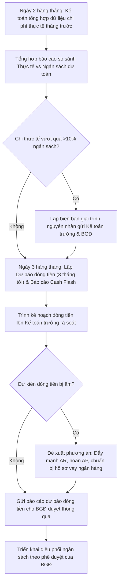

# 8.6 Kiểm soát Ngân sách

## 1. Mục đích
- Lập, theo dõi và kiểm soát ngân sách hoạt động — đảm bảo dòng tiền ổn định.

## 2. Cấu trúc Ngân sách

| Hạng mục | Tỷ trọng ước tính | Ghi chú |
|----------|-------------------|--------|
| **Mua hàng NK** (FOB + Thuế + Cước) | 50-60% | Lớn nhất, chi theo lô |
| **Nhân sự** (Lương, BH) | 10-15% | Chi đều hàng tháng |
| **Kho vận** (thuê kho, điện lạnh) | 5-10% | Chi đều |
| **Marketing** (Event, Mẫu, In ấn) | 5-10% | Biến động theo mùa (xem chi tiết [8.10 Quản lý Chi phí Tasting & Tiếp khách](8.10_quan_ly_chi_phi_tasting_tiep_khach.md)) |
| **Pháp lý** (Kiểm nghiệm, GP) | 2-5% | Phát sinh khi có SP mới |
| **Khác** (Văn phòng, IT, Đi lại, Tiếp khách) | 5-10% | Chi đều. Hạn mức tiếp khách xem tại [8.10 Quản lý Chi phí Tasting & Tiếp khách](8.10_quan_ly_chi_phi_tasting_tiep_khach.md) |

## 3. Quy trình Quản lý Ngân sách

### 3.1 Quy trình thực hiện
#### Bước 1: Lập Ngân sách Năm (Tháng 12 cho năm sau)
1. BGĐ + Kế toán lập **Ngân sách dự kiến** theo hạng mục
2. Dựa trên: Kế hoạch nhập hàng (QT 3.1), Doanh thu mục tiêu, Chi phí năm trước
3. Phê duyệt

#### Bước 2: Theo dõi Hàng tháng
1. Kế toán đối chiếu: Chi thực tế vs Ngân sách
2. Nếu vượt > 10% → Báo BGĐ, giải thích lý do
3. Nếu tiết kiệm → Ghi nhận, cân nhắc chuyển cho hạng mục khác

#### Bước 3: Quản lý Dòng tiền (Cash Flow)
1. **Lịch Báo cáo & Dự báo định kỳ**:
   - **Báo cáo Dòng tiền trong tháng (nội bộ)**: Lập dự thảo báo cáo vào ngày **02 hàng tháng** (R) nhằm phản ánh dòng tiền thực tế phát sinh trong tháng trước.
   - **Dự báo Dòng tiền tháng**: Lập dự báo dòng tiền cho tháng hiện tại và 3 tháng tới vào ngày **03 hàng tháng** (R) để BGĐ chủ động phương án điều phối vốn.
   - **Báo cáo số dư tiền mặt & tiền gửi tại các tài khoản ngân hàng**: Cập nhật báo cáo số dư thực tế **hàng ngày** (Daily Cash Flash).
2. Dự báo dòng tiền 3 tháng tới:
   - Thu: Doanh thu dự kiến + Thu công nợ [QT 8.2](8.2_cong_no_phai_thu.md)
   - Chi: Mua hàng NK + Lương + Chi phí cố định [QT 8.3](8.3_cong_no_phai_tra.md)
3. Nếu dự kiến thiếu hụt → lên kế hoạch:
   - Đẩy thu công nợ sớm
   - Delay đơn NK nếu được
   - Xin vay ngắn hạn (nếu cần)

### 3.2 Sơ đồ quy trình quản lý ngân sách & dòng tiền

### 3.3 Ma trận phân quyền (RACI) quản lý ngân sách
| Nhiệm vụ / Vị trí | Kế toán thanh toán | Kế toán tổng hợp | Kế toán trưởng | Ban Giám Đốc | Các phòng ban (Sales, Marketing...) |
| :--- | :---: | :---: | :---: | :---: | :---: |
| Lập báo cáo Daily Cash Flash hàng ngày | **R** | — | **I** | **I** | — |
| Đối chiếu chi thực tế vs Ngân sách tháng | — | **R** | **C** | **I** | **C** |
| Lập dự báo dòng tiền 3 tháng (ngày 03) | — | **R** | **C** | **I** | — |
| Lập kế hoạch phân bổ & duyệt ngân sách năm| — | **C** | **R** | **A** | **C** |
| Đề xuất phương án xử lý khi hụt dòng tiền | — | **C** | **R** | **A** | — |

## 4. Biểu mẫu
- 📥 **Form 8.6-A:** [Ngan_sach_Hang_thang.xlsx](../../../sources/Forms/Form_8.6-A_Ngan_sach.xlsx)

## 5. KPI

| KPI | Mục tiêu |
|-----|---------|
| Chi thực tế / Ngân sách | 90-110% |
| Dòng tiền dương | Mọi tháng |
| Dự trữ tiền mặt | ≥ 2 tháng chi phí cố định |

## 6. Tài liệu Liên quan
- ↔ Liên quan: [8.7 BCTC](8.7_bao_cao_tai_chinh.md) | [3.1 Kế hoạch Đặt hàng](../03_mua_hang/3.1_du_bao_nhu_cau.md) | [8.10 Quản lý Chi phí Tasting & Tiếp khách](8.10_quan_ly_chi_phi_tasting_tiep_khach.md)
