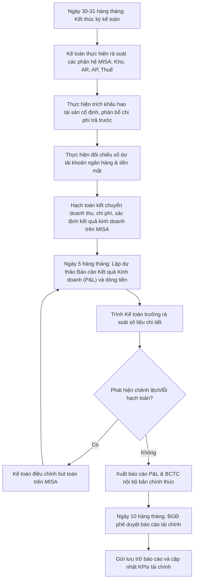

# 8.7 Báo cáo Tài chính

## 1. Mục đích
- Lập báo cáo tài chính định kỳ cho BGĐ và cơ quan thuế.

## 2. Hệ thống Báo cáo

| Báo cáo | Tần suất | Lập dự thảo (R) | Hạn hoàn thành/Nộp (D) | Người lập | Ghi chú |
|:---|:---|:---|:---|:---|:---|
| **P&L (Kết quả KD)** | Hàng tháng (nội bộ) | Ngày 05 hàng tháng | Ngày 10 tháng sau | Kế toán | Đánh giá kết quả kinh doanh tháng trước |
| **Bảng cân đối KT** | Hàng quý (nội bộ) | Ngày 10 tháng đầu quý sau | Ngày 15 sau quý | Kế toán | Cân đối tài sản và nguồn vốn |
| **Cash Flow (Dòng tiền)** | Hàng tháng | Ngày 02 hàng tháng | Ngày 10 tháng sau | Kế toán | Phối hợp với [QT 8.6](8.6_kiem_soat_ngan_sach.md) |
| **BCTC Nội bộ Năm** | Hàng năm | — | Ngày 30/01 năm sau | Kế toán | Quyết toán số liệu hoạt động cả năm |
| **BCTC Năm (cho thuế)** | Hàng năm | — | Ngày 31/03 năm sau | Kế toán + Kiểm toán | Báo cáo chính thức gửi cơ quan thuế [QT 8.5](8.5_quan_ly_thue.md) |

## 3. Nội dung P&L Hàng tháng

| Hạng mục | Tháng này | Cộng dồn YTD | % DT |
|----------|----------|------------|------|
| **Doanh thu bán hàng** | | | 100% |
| (-) Giá vốn (COGS) | | | ~55-65% |
| **= Lãi gộp** | | | ~35-45% |
| (-) Chi phí bán hàng | | | ~10-15% |
| (-) Chi phí quản lý | | | ~10-15% |
| **= Lãi trước thuế** | | | ~10-20% |
| (-) Thuế TNDN (20%) | | | |
| **= Lãi ròng** | | | |

### 3.1 Sơ đồ quy trình khóa sổ & lập BCTC

### 3.2 Ma trận phân quyền (RACI) lập báo cáo tài chính
| Nhiệm vụ / Vị trí | Kế toán viên | Kế toán tổng hợp | Kế toán trưởng | Ban Giám Đốc | Nhân viên Sales (khi yêu cầu) |
| :--- | :---: | :---: | :---: | :---: | :---: |
| Thực hiện hạch toán chi tiết & khóa sổ phụ | **R** | **C** | **I** | — | — |
| Lập dự thảo báo cáo P&L nội bộ hàng tháng | — | **R** | **C** | — | — |
| Phê duyệt & phát hành BCTC định kỳ | — | — | **R** | **A** | — |
| Kết xuất báo cáo ad-hoc hỗ trợ Sales (SLA 4h) | **R** | — | **I** | — | **C** |
| Theo dõi & báo cáo KPIs tài chính (ngày 03) | — | **R** | **R** | **A** | — |

## 4. KPI Tài chính

- **Báo cáo Tình hình thực hiện KPIs**: Lập dự thảo báo cáo vào ngày **03 hàng tháng** (R) để đánh giá các chỉ số tài chính tháng trước và gửi Ban Giám đốc.

| KPI | Mục tiêu | Tần suất |
|-----|---------|----------|
| Gross Margin | ≥ 35% | Hàng tháng |
| Net Margin | ≥ 10% | Hàng tháng |
| Current Ratio | ≥ 1.5 | Hàng quý |
| Inventory Turnover | ≥ 4x/năm | Hàng quý |
| DSO | ≤ 20 ngày | Hàng tháng |

## 5. Yêu cầu Báo cáo Nội bộ (Ad-hoc Internal Requests)
- **Quy tắc phối hợp:** Bộ phận Kế toán có trách nhiệm hỗ trợ, kết xuất và gửi báo cáo chi tiết liên quan đến doanh số, công nợ khách hàng hoặc chi tiết thanh toán cho nhân viên Sales (Sales Rep) khi nhận được yêu cầu để phục vụ công việc và đối chiếu dữ liệu kinh doanh.
- **SLA phản hồi:** Kế toán phải gửi báo cáo được yêu cầu cho bộ phận Sales trong vòng **04 giờ làm việc** kể từ khi nhận được yêu cầu chính thức qua Email/WhatsApp.

## 6. Tài liệu Liên quan
- ↔ Liên quan: [8.4 COGS](8.4_gia_von_cogs.md) | [8.5 Thuế](8.5_quan_ly_thue.md) | [8.6 Ngân sách](8.6_kiem_soat_ngan_sach.md)
- ↔ Liên quan: [6.7 BC Doanh số](../06_ban_hang/6.7_bao_cao_doanh_so.md)
