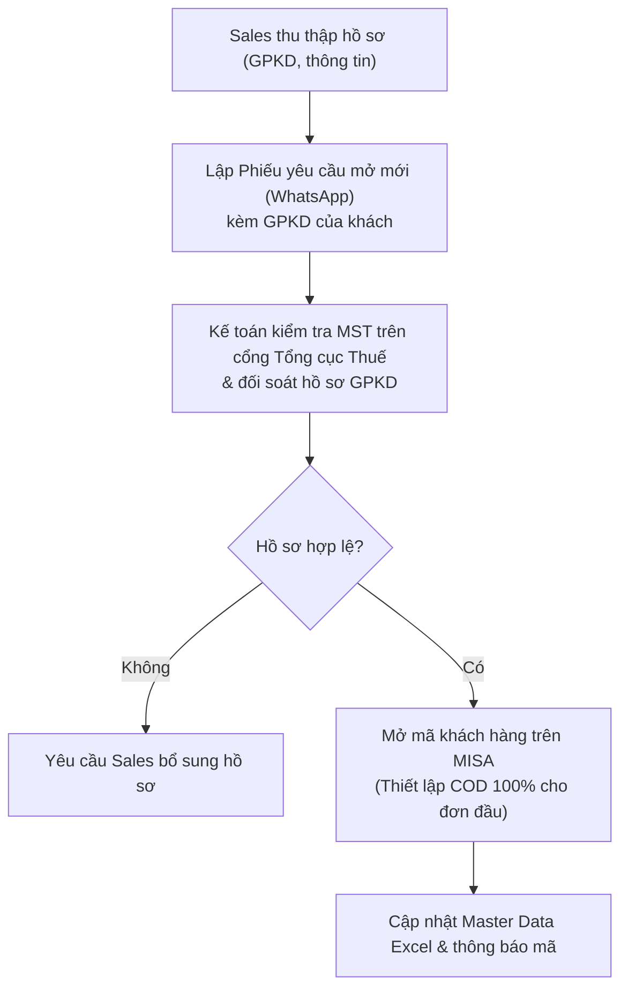

# 8.8 Quy trình Quản lý Master Data Khách hàng

## 1. Mục đích & Phạm vi
- **Mục đích:** Chuẩn hóa quy tắc đặt mã khách hàng, quy trình khai báo thông tin và cơ chế ánh xạ (mapping) giữa **đối tượng xuất hóa đơn (pháp nhân)** và **đối tượng vận hành (thương hiệu/cửa hàng con)**. Giải quyết triệt để tình trạng một khách hàng có nhiều tên trên sổ chi tiết, giúp báo cáo doanh số chuẩn xác theo thương hiệu.
- **Phạm vi áp dụng:** Bộ phận Kinh doanh (Sales), Bộ phận Kế toán (kế toán bán hàng, kế toán tổng hợp) và bộ phận quản lý dữ liệu Master Data tại Lyscellar.

---

## 2. Quy trình Khai báo Khách hàng Mới

### Các quy định bắt buộc:
1.  **Hồ sơ pháp lý:** Đối với tất cả khách hàng mới là pháp nhân/cơ sở kinh doanh (HoReCa, Đại lý, B2B), nhân viên Sales bắt buộc phải yêu cầu khách hàng cung cấp bản sao **Giấy phép đăng ký kinh doanh (GPKD) có chữ ký, đóng dấu xác nhận (đóng dấu treo/sao y bản chính) hoặc được công chứng hợp lệ** để phòng Pháp lý tiến hành soạn thảo hợp đồng chính thức. Bộ phận Kế toán tuyệt đối không duyệt tạo mã nếu thiếu GPKD của khách hàng hoặc GPKD không đáp ứng các yêu cầu pháp lý này.
2.  **Quy tắc thanh toán đơn đầu:** **Các đơn hàng đầu tiên bắt buộc phải thanh toán COD 100%** (hoặc chuyển khoản trả trước trước khi giao hàng) nếu chưa hoàn thành ký kết hợp đồng phân phối chính thức giữa hai bên.

### 2.1 Ma trận phân quyền (RACI) quản lý master data khách hàng
| Nhiệm vụ / Vị trí | Nhân viên Sales | Kế toán bán hàng | Kế toán trưởng | Ban Giám Đốc | Pháp lý |
| :--- | :---: | :---: | :---: | :---: | :---: |
| Thu thập hồ sơ GPKD & điền Form 8.8-A | **R** | — | — | — | — |
| Thẩm định tính pháp lý của GPKD khách hàng | — | — | — | — | **R** |
| Kiểm tra chéo MST & thông tin đăng ký thuế | — | **R** | — | — | — |
| Phê duyệt hạn mức công nợ khách hàng mới | **C** | **C** | **C** | **A** | — |
| Tạo mã cha/mã con trên phần mềm MISA | — | **R** | **I** | — | — |
| Ánh xạ nhóm thương hiệu (Master Data) | — | **R** | **I** | — | — |

---

## 3. Quy tắc Đặt Mã Khách hàng trên Phần mềm Kế toán (MISA/Fast)

Để đảm bảo tính đồng bộ, kế toán tuân thủ quy tắc đặt mã dưới đây khi thêm mới khách hàng. **Tuyệt đối không sử dụng Mã số thuế (MST) trực tiếp làm Mã khách hàng** để tránh việc mã quá dài, khó ghi nhớ và không đồng bộ về mặt định dạng chữ.

### 3.1 Kênh HORECA (Nhà hàng - Khách sạn - Cafe)
Để hỗ trợ tốt nhất cho phân tích doanh số và vận hành thực tế, **mã khách hàng HORECA sẽ được đặt theo dạng số (Numeric)** đại diện cho đối tác/thương hiệu thay vì đặt theo tên chữ viết tắt. Thông tin pháp nhân và mã số thuế vẫn được lưu trữ đầy đủ trong Master Data để phục vụ xuất hóa đơn.

*   **Mã Cha (Đại diện cho Nhóm Thương Hiệu / Tập đoàn / Pháp nhân cha):** `HR1` + 4 chữ số tăng dần (Ví dụ: `HR1XXXX`)
    *   *Mục đích:* Gom nhóm báo cáo doanh số tổng hợp và đối chiếu công nợ của toàn bộ chuỗi/nhóm thương hiệu.
    *   *Ví dụ:* 
        * Hộ kinh doanh Nguyễn Đạo Tiến (Vox) $\rightarrow$ Mã cha: `HR10001`
        * Công ty TNHH Liên doanh Khách sạn Thống Nhất Metropole $\rightarrow$ Mã cha: `HR10006`
        * Công ty TNHH Tinh Hoa Ẩm Thực (Salmonoid/Sente/Pincho) $\rightarrow$ Mã cha: `HR10022`
*   **Mã Con (Vận hành từng cơ sở cụ thể):** `Mã Cha` + `-` + 2 chữ số nhánh (Ví dụ: `HR1XXXX-XX`)
    *   *Mục đích:* Lên đơn hàng vận chuyển thực tế, theo dõi nhập-xuất-tồn và công nợ chi tiết của từng địa điểm.
    *   *Ví dụ:* 
        * Metropole Hotel $\rightarrow$ `HR10006-01`
        * Pincho - Tapas Kitchen and Drinks $\rightarrow$ `HR10022-01`
        * Sente (Senté Old Quarter) $\rightarrow$ `HR10022-03`
*   **Liên kết:** Cấu hình trường "Khách hàng cha" của các mã con trỏ về đúng mã cha thương hiệu tương ứng.

### 3.2 Kênh Corporate (Doanh nghiệp mua quà tặng, sự kiện)
*   **Mã Cha (nếu có chuỗi/Tập đoàn mẹ):** `CP1` + 4 chữ số tăng dần (Ví dụ: `CP1XXXX`)
    *   *Ví dụ:* `CP10003` (Tổng Vietcombank).
*   **Mã Con (Chi nhánh/Công ty thành viên):** `Mã Cha` + `-` + 2 chữ số chi nhánh (Ví dụ: `CP1XXXX-XX`)
    *   *Ví dụ:* `CP10003-01` (Vietcombank Sở giao dịch), `CP10003-02` (Vietcombank Ba Đình), `CP10003-03` (Vietcombank Phố Hiến).

### 3.3 Kênh Retail (Khách lẻ)
*   **Khách VIP / Thường xuyên (Theo dõi điểm, doanh số):** `RT1` + 4 chữ số tăng dần (Ví dụ: `RT1XXXX`)
    *   *Ví dụ:* Hộ kinh doanh Vũ Anh Tùng $\rightarrow$ Mã cha: `RT10001`, Mã con: `RT10001-01`.
*   **Khách lẻ vãng lai:** `RT10007` (Mã dùng chung để ghi nhận doanh số bán lẻ không cần theo dõi công nợ hay thông tin chi tiết, mã con tương ứng `RT10007-01`).

---

## 4. Hướng dẫn Lập Báo cáo Doanh số quản trị (Mapping Thương hiệu)

Khi xuất dữ liệu bán hàng thô từ phần mềm MISA ra Excel để làm báo cáo, kế toán và bộ phận phân tích thực hiện ánh xạ theo các bước:

1.  **Trích xuất cột Mã Khách Hàng (Mã con):** File dữ liệu thô sẽ chứa các mã chi tiết dạng số như `HR10022-01`, `HR10022-03`.
2.  **Sử dụng hàm XLOOKUP hoặc VLOOKUP:**
    *   Tra cứu Mã khách hàng này đối chiếu với tệp [Master Data - Khách hàng.xlsx](../../../sources/Master%20data/Master%20Data%20%20-%20Khách%20hàng.xlsx) hoặc các danh sách khách hàng trong Wiki như [khach_hang_horeca.md](../../entities/khach_hang_horeca.md).
    *   Lấy ra cột **Nhóm Thương Hiệu (Brand Group)**.
3.  **Tạo báo cáo Pivot Table:**
    *   Kéo cột **Nhóm Thương Hiệu** vào phần *Rows* của Pivot Table.
    *   Kéo cột *Doanh thu* vào phần *Values*.
    *   *Kết quả đạt được:* Toàn bộ doanh số của các cơ sở con sẽ tự động gộp về một dòng duy nhất cho thương hiệu cha (Ví dụ: Toàn bộ doanh số của chi nhánh Tây Hồ và Đào Tấn gộp về dòng **Cousins Restaurant**), giúp BGĐ thấy rõ bức tranh tổng thể về sức mua của từng khách hàng lớn.

---

## 5. Chỉ số đánh giá Hiệu quả (KPIs)

| Chỉ số KPI | Mục tiêu đạt được | Tần suất đo lường |
| :--- | :--- | :---: |
| Thời gian tạo mã khách hàng mới trên MISA | **≤ 2 giờ làm việc** kể từ lúc nhận đủ hồ sơ | Hàng tuần |
| Tỷ lệ thông tin MST/địa chỉ bị sai sót | **0%** (100% khớp cổng GDT) | Hàng tháng |
| Tỷ lệ khách hàng có đầy đủ GPKD đính kèm | **100%** đối với pháp nhân có công nợ | Hàng quý |
| Sự trùng lặp mã khách hàng trên phần mềm | **0%** | Hàng năm |

---

## 6. Biểu mẫu & Tài liệu Liên quan

### 6.1 Biểu mẫu Tạo mới Khách hàng (Form 8.8-A & Phiếu Onboarding)
Khi phát sinh khách hàng mới, bộ phận bán hàng bắt buộc phải điền đầy đủ các thông tin vào phiếu trước khi gửi kế toán duyệt tạo mã:

| STT | Thông tin yêu cầu | Chi tiết / Định dạng | Bắt buộc |
|---|---|---|---|
| 1 | **Tên pháp nhân (xuất HĐ)** | Tên đầy đủ theo ĐKKD (Ví dụ: CÔNG TY TNHH BISTRO FRANCAIS) | Có (nếu cần xuất HĐ) |
| 2 | **Mã số thuế (MST)** | 10 hoặc 13 số | Có (nếu cần xuất HĐ) |
| 3 | **Địa chỉ xuất hóa đơn** | Theo ĐKKD | Có (nếu cần xuất HĐ) |
| 4 | **Tên thương hiệu (Mã con)** | Tên thương hiệu nhận diện + Tên chi nhánh (Ví dụ: Cousins Tây Hồ) | Có |
| 5 | **Địa chỉ giao hàng thực tế** | Địa chỉ chi tiết nhận rượu vang | Có |
| 6 | **SĐT nhận hàng** | SĐT của chi nhánh hoặc người nhận hàng | Có |
| 7 | **Người liên hệ trực tiếp** | Họ tên + Chức vụ + SĐT liên hệ | Có |
| 8 | **Phân loại kênh bán** | HoReCa / Corporate / Retail | Có |
| 9 | **Đề xuất công nợ** | COD / Chuyển khoản trước / Theo chính sách 15-30 ngày | Có |
| 10 | **Nhân viên Sales phụ trách** | Họ và tên nhân viên kinh doanh quản lý | Có |

*   📥 **Tải biểu mẫu Excel:** [Form_8.8-A: Phiếu yêu cầu mở mới & tạo mã khách hàng (Open Account)](../../../sources/Forms/Form_8.8-A_Yeu_cau_Tao_ma_KH.xlsx) (Bao gồm Bảng đánh giá tiêu chí Độ lớn & Uy tín để đề xuất công nợ, đi kèm [Form_6.1-B_Phu_luc_Gia_Dac_biet.xlsx](../../../sources/Forms/Form_6.1-B_Phu_luc_Gia_Dac_biet.xlsx) nếu khách hàng có cơ chế giá đặc biệt).

### 6.2 Tài liệu liên quan
- 👥 Dữ liệu nguồn: [Khách hàng HORECA](../../entities/khach_hang_horeca.md) | [Khách hàng Corporate](../../entities/khach_hang_corporate.md)
- 💰 Liên quan kế toán: [8.2 Công nợ Phải thu](8.2_cong_no_phai_thu.md) | [8.7 Báo cáo Tài chính](8.7_bao_cao_tai_chinh.md)
