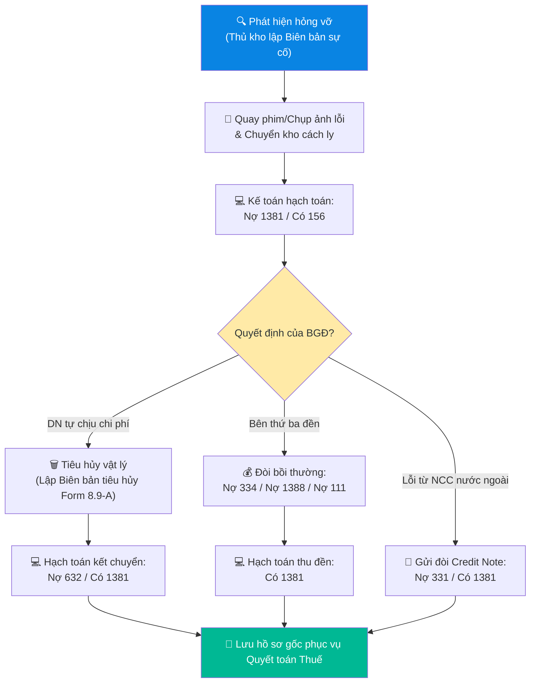

# 8.9 Xử lý Tài chính Hàng hỏng vỡ & Hao hụt

## 1. Mục đích & Phạm vi
- **Mục đích:** Hướng dẫn chi tiết phương pháp hạch toán kế toán và hoàn thiện bộ hồ sơ pháp lý Thuế đối với các trường hợp rượu vang bị đổ vỡ, hư hỏng hoặc lỗi nút bần (corked/TCA) trong quá trình nhập kho, bảo quản, vận chuyển. Đảm bảo toàn bộ chi phí hao hụt hàng tồn kho được tính là chi phí hợp lệ khi tính thuế Thu nhập doanh nghiệp (TNDN) và không phải điều chỉnh giảm thuế GTGT đầu vào được khấu trừ theo luật định.
- **Phạm vi:** Áp dụng cho bộ phận Kế toán, Kế toán kho, Kế toán trưởng và Ban Giám Đốc tại Lyscellar.

## 2. Quy định Pháp luật Thuế (Việt Nam)
Căn cứ Thông tư 78/2014/TT-BTC, Thông tư 96/2015/TT-BTC và Thông tư 219/2013/TT-BTC của Bộ Tài chính:
- Giá trị hàng hóa tổn thất do hư hỏng sinh lý hóa tự nhiên (như rượu vang bị hỏng bần, cooked do nhiệt độ vận chuyển trước đó, hoặc đổ vỡ do va chạm cơ học thông thường trong kho) được tính vào chi phí được trừ khi xác định thuế TNDN, với điều kiện doanh nghiệp hoàn thiện đầy đủ hồ sơ chứng minh.
- Thuế GTGT đầu vào của hàng hóa bị tổn thất được khấu trừ toàn bộ nếu có hồ sơ chứng minh nguyên nhân khách quan và đã lập biên bản xử lý rõ ràng.

### ⚠️ BỘ HỒ SƠ THUẾ BẮT BUỘC (Để xuất trình khi Quyết toán Thuế):
1. **Biên bản kiểm kê/sự cố hư hỏng hàng hóa:** Ghi rõ mã SKU, số lượng, trị giá vốn, nguyên nhân hư hỏng (bể vỡ, rò rỉ, lỗi mùi vị TCA). Có chữ ký xác nhận của Thủ kho, nhân viên kế toán và Quản lý Kho.
2. **Quyết định xử lý của Ban Giám gốc:** Văn bản phê duyệt phương án xử lý tài chính (Doanh nghiệp chịu chi phí / Khấu trừ lương người làm vỡ / Đòi bồi thường bên vận chuyển / Đòi bồi thường NCC nước ngoài).
3. **Biên bản tiêu hủy hàng hóa (Form 8.9-A):** Ghi rõ thời gian, địa điểm, phương thức tiêu hủy rượu hỏng. Có chữ ký đại diện Ban Giám đốc, Kế toán trưởng và Thủ kho.
4. **Hình ảnh / Video minh chứng:** Chụp ảnh cận cảnh lỗi của chai rượu (nhãn, nút bần, vết nứt) và chụp ảnh/quay video lúc tiến hành hủy rượu (đổ rượu hỏng, đập vỡ cổ chai hoặc gom vỏ chai vỡ đưa đi xử lý rác thải).
5. **Credit Note từ NCC / Biên bản đền bù của Shipper:** Đính kèm nếu có bồi thường để giải trình phần giảm trừ chi phí.

## 3. Quy trình Hạch toán Kế toán trên MISA

### 3.1 Hướng dẫn hạch toán định khoản
#### Trường hợp 1: Hao hụt/Hỏng vỡ thuộc trách nhiệm chi phí của Lyscellar
*(Hỏng hóc do lưu trữ kho, hao hụt trong định mức vận chuyển nội bộ)*

1. **Khi phát hiện hàng hỏng vỡ và làm Biên bản sự cố (đưa vào kho cách ly):**
   - Hạch toán ghi giảm tồn kho hàng tốt, chuyển vào tài sản thiếu chờ xử lý:
     - **Nợ TK 1381** - Tài sản thiếu chờ xử lý *(Theo giá trị giá vốn)*
     - **Có TK 156** - Hàng hóa *(SKU chi tiết)*

2. **Khi có Quyết định phê duyệt xử lý tiêu hủy của BGĐ (tính vào chi phí doanh nghiệp):**
   - Hạch toán kết chuyển vào giá vốn hàng bán:
     - **Nợ TK 632** - Giá vốn hàng bán (nếu xác định là hao hụt định mức bình thường trong vận hành) hoặc **Nợ TK 811** - Chi phí khác (nếu do thiên tai, sự cố bất khả kháng quy mô lớn)
     - **Có TK 1381** - Tài sản thiếu chờ xử lý

---

#### Trường hợp 2: Hỏng vỡ do lỗi của Nhân viên giao nhận hoặc Bên vận chuyển thứ ba
*(Bắt đền nhân viên hoặc đối tác vận chuyển)*

1. **Khi phát hiện hàng hỏng vỡ (lúc giao nhận):**
   - **Nợ TK 1381** - Tài sản thiếu chờ xử lý
     - **Có TK 156** - Hàng hóa

2. **Khi xác định mức bồi thường và đối tượng đền bù:**
   - Nếu trừ lương nhân viên giao nhận của Lyscellar:
     - **Nợ TK 334** - Phải trả người lao động *(Khấu trừ vào lương tháng)*
     - **Có TK 1381** - Tài sản thiếu chờ xử lý
   - Nếu đối tác vận chuyển ngoài (Grab, xe tải thuê ngoài) đền tiền mặt hoặc trừ công nợ:
     - **Nợ TK 1111 / 1121** (Thu tiền mặt/chuyển khoản) hoặc **Nợ TK 1388** (Phải thu khác - ghi nợ đơn vị vận chuyển)
     - **Có TK 1381** - Tài sản thiếu chờ xử lý

---

#### Trường hợp 3: Rượu bị lỗi chất lượng (TCA/Nút bần) từ Nhà cung cấp nước ngoài
*(Lỗi sản xuất được NCC chấp nhận đền bù bằng Credit Note)*

1. **Khi phát hiện rượu bị lỗi chất lượng (TCA/Oxidized) và NCC đồng ý bồi thường:**
   - Chuyển chai rượu lỗi sang khu vực cách ly, giữ nguyên trạng nút bần lỗi làm bằng chứng đối chiếu.
   - Ghi nhận giảm hàng hóa chờ Credit Note:
     - **Nợ TK 1381** - Tài sản thiếu chờ xử lý
     - **Có TK 156** - Hàng hóa
2. **Khi nhận được Credit Note chính thức từ NCC nước ngoài (Giảm trừ công nợ mua hàng lô sau):**
   - Hạch toán giảm khoản phải trả NCC:
     - **Nợ TK 331** - Phải trả cho người bán *(NCC tương ứng)*
     - **Có TK 1381** - Tài sản thiếu chờ xử lý
   - *Lưu ý:* Nếu NCC bù bằng hàng hóa ở lô tiếp theo, kế toán lập PNK lô mới ghi nhận hàng bù giá 0đ và hạch toán giảm TK 1381 tương ứng.

### 3.2 Ma trận phân quyền (RACI) xử lý hàng hỏng vỡ hao hụt
| Nhiệm vụ / Vị trí | Thủ kho / Nhân viên kho | Kế toán kho | Kế toán trưởng | Ban Giám Đốc | Nhân viên Sales/Giao nhận |
| :--- | :---: | :---: | :---: | :---: | :---: |
| Phát hiện hàng hỏng vỡ & lập Biên bản sự cố | **R** | **C** | — | — | **R** |
| Chụp ảnh, quay video làm bằng chứng lỗi | **R** | — | — | — | — |
| Hạch toán ghi nhận tổn thất (TK 1381) | — | **R** | **I** | — | — |
| Phê duyệt quyết định phương án xử lý tài chính | — | **C** | **C** | **A** | — |
| Thực hiện tiêu hủy vật lý & ký Form 8.9-A | **R** | **R** | **C** | **A** | — |
| Đòi bồi thường (Shipper/NCC) hoặc trừ lương | — | **R** | **C** | **A** | **C** |

---

## 4. Sơ đồ luồng chứng từ Kế toán

---

## 5. Chỉ số đánh giá Hiệu quả (KPIs)

| Chỉ số KPI | Mục tiêu đạt được | Tần suất đo lường |
| :--- | :--- | :---: |
| Thời gian lập biên bản sự cố từ khi phát hiện | **≤ 24 giờ** | Hàng tuần |
| Thời gian hạch toán hàng hỏng trên MISA | **≤ 48 giờ** kể từ khi nhận biên bản sự cố | Hàng tuần |
| Tỷ lệ đầy đủ hồ sơ thuế (ảnh, biên bản tiêu hủy) | **100%** đối với mọi SKU bị hủy | Hàng tháng |
| Thời gian giải quyết Credit Note từ NCC ngoại | **≤ 15 ngày làm việc** | Hàng quý |

---

## 6. Biểu mẫu & Tài liệu Liên quan

### 6.1 Biểu mẫu
- **Form 8.9-A: Biên bản Tiêu hủy Hàng hóa Hư hỏng**
  - *Nội dung:* Ngày giờ tiêu hủy, thành phần ban giám sát (BGĐ, Kế toán, Thủ kho), danh mục sản phẩm tiêu hủy (Mã SKU, tên rượu, số lượng, đơn giá vốn, thành tiền), phương thức tiêu hủy (khui đổ rượu xuống đường thoát nước thải, đập vỡ cổ chai vỏ/gửi đơn vị thu gom chai thủy tinh), ký tá xác nhận của các bên.

### 6.2 Tài liệu Liên quan
- ← Liên quan: [5.7 Xử lý Hàng lỗi & Hàng hư hỏng](../05_kho_van/5.7_xu_ly_hang_loi.md)
- ↔ Liên quan: [8.4 Giá vốn COGS](8.4_gia_von_cogs.md) | [8.3 Công nợ Phải trả (AP)](8.3_cong_no_phai_tra.md)
