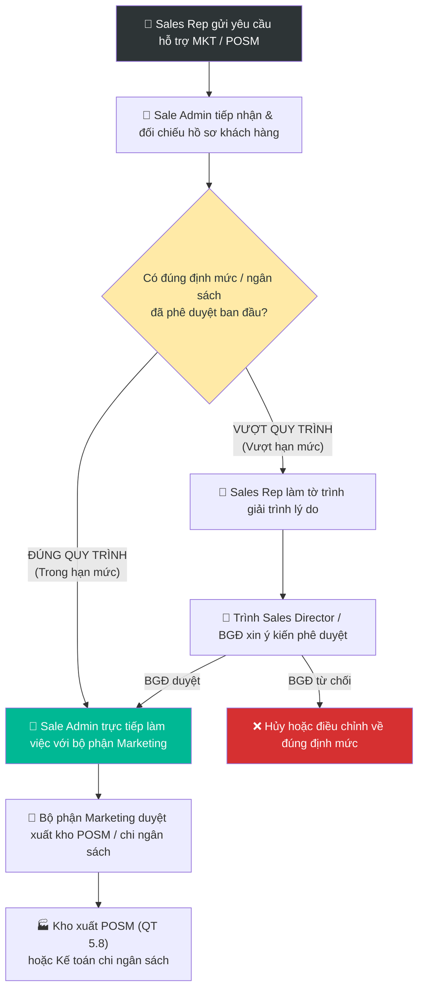

# 9.2 Quy trình Phê duyệt Ngân sách Marketing & POSM Khách hàng

## 1. Mục đích & Phạm vi
- **Mục đích:** Thiết lập định mức ngân sách marketing và vật phẩm hỗ trợ bán hàng (POSM) ban đầu cho khách hàng mở mới; đẩy nhanh tiến độ phục vụ bằng cách trao quyền chủ động cho Sale Admin và Marketing khi yêu cầu nằm trong hạn mức tiêu chuẩn.
- **Phạm vi áp dụng:** Bộ phận Kinh doanh (Sales), bộ phận Sale Admin, bộ phận Marketing và Ban Giám đốc (BGĐ).
- **Tần suất thực hiện:** Áp dụng khi ký hợp đồng khách hàng mới (đặc biệt là kênh HoReCa và Đại lý) và phát sinh yêu cầu hỗ trợ thương mại.

---

## 2. Chính sách Định mức Ngân sách & POSM Mở mới (Mẫu tham khảo & Giới hạn 3%)

Khi thiết lập hồ sơ khách hàng mới, tùy thuộc vào quy mô và giá trị đơn hàng cam kết đầu tiên, ngân sách marketing hoặc gói vật phẩm POSM hỗ trợ được đề xuất dựa trên định mức **mẫu tham khảo** dưới đây.

> [!IMPORTANT]
> **Nguyên tắc khống chế ngân sách:**
> Tổng ngân sách marketing thực tế được phê duyệt (bao gồm cả chi phí thiết kế wine list, menu, và giá trị quy đổi POSM) **không được vượt quá 3%** giá trị đơn hàng đầu tiên (hoặc doanh số cam kết). Bảng định mức dưới đây chỉ mang tính chất **mẫu ví dụ minh họa** làm căn cứ tham chiếu và không được coi là hạn mức cố định.

| Nhóm khách hàng | Đơn hàng đầu tiên cam kết | Ngân sách Marketing tối đa (Mẫu tham khảo) | Định mức vật phẩm POSM tham chiếu (Mẫu tham khảo) |
|---|---|---|---|
| **Hạng A (Key Account)** | > 30.000.000 VNĐ | Tối đa 3% giá trị đơn hàng | Hỗ trợ xô đá, ly pha lê cao cấp, tạp dề Sommelier, khui rượu chuyên nghiệp & tent card đặt bàn |
| **Hạng B (HoReCa vừa/Đại lý)** | 15.000.000 - 30.000.000 VNĐ | Tối đa 3% giá trị đơn hàng | Hỗ trợ xô đá, ly pha lê tiêu chuẩn, tạp dề, khui rượu & tent card đặt bàn |
| **Hạng C (Khách sỉ nhỏ)** | 5.000.000 - 15.000.000 VNĐ | Không hỗ trợ ngân sách | Hỗ trợ xô đá & khui rượu |

*Lưu ý quan trọng về tính linh hoạt:*
- Định mức ngân sách và vật phẩm POSM trên chỉ mang tính chất tham khảo mẫu. Danh mục vật phẩm, chủng loại và số lượng hỗ trợ thực tế sẽ **thay đổi linh hoạt tùy theo từng thời điểm, các chiến dịch marketing hiện hành và lượng tồn kho POSM thực tế** do bộ phận Marketing cập nhật định kỳ dưới sự phê duyệt của BGĐ, và bắt buộc phải nằm trong giới hạn 3% giá trị đơn hàng.
- Giá trị quy đổi POSM được tính dựa trên giá vốn nhập kho của vật phẩm (COGS POSM) tại thời điểm xuất kho theo [QT 5.8 Quản lý POSM & Hộp quà](../05_kho_van/5.8_quan_ly_posm_hop_qua.md).

---

## 3. Quy trình thực hiện & Phê duyệt

Khi khách hàng mới có nhu cầu nhận POSM hoặc hỗ trợ ngân sách marketing thiết kế wine list, menu:

### Luồng 1: Đúng quy trình / Trong hạn mức ngân sách
1. **Sales Rep** lập [Phiếu yêu cầu cấp phát POSM & Hộp quà (Form 5.8-A)](../../../sources/Forms/Form_5.8-A_Phieu_yeu_cau_cap_phat_POSM.xlsx) hoặc Yêu cầu hỗ trợ ngân sách marketing gửi cho **Sale Admin**.
2. **Sale Admin** đối chiếu yêu cầu với hồ sơ khách hàng mới mở:
   - Nếu tổng giá trị yêu cầu **nằm trong ngân sách marketing/định mức POSM tiêu chuẩn** của hạng khách hàng đó $\rightarrow$ **ĐÚNG QUY TRÌNH**.
3. **Sale Admin** chủ động chuyển tiếp yêu cầu và làm việc trực tiếp với **bộ phận Marketing** để xử lý bàn giao POSM hoặc hỗ trợ khách thiết kế menu/wine list. 
4. *Kết quả:* Bộ phận Marketing phê duyệt xuất kho POSM hoặc duyệt chi phí mà không cần phải trình ký lên cấp trên, giúp đẩy nhanh tiến độ hỗ trợ khách hàng mở mới.

### Luồng 2: Vượt quy trình / Vượt hạn mức ngân sách
1. Nếu khách hàng yêu cầu hỗ trợ vượt quá ngân sách marketing ban đầu hoặc vượt định mức POSM quy định tại Mục 2 $\rightarrow$ **VƯỢT QUY TRÌNH**.
2. **Sales Rep** phụ trách bắt buộc phải làm tờ trình giải trình lý do đặc biệt (Ví dụ: khách có tiềm lực sản lượng rất lớn trong tương lai, cam kết độc quyền phân phối rượu của Lyscellar).
3. Sales gửi tờ trình lên **Sales Director** hoặc **Ban Giám đốc (BGĐ)** để xin ý kiến chỉ đạo phê duyệt ngoại lệ.
4. Chỉ sau khi có sự đồng ý (Approve) bằng văn bản hoặc tin nhắn/email từ BGĐ, Sale Admin mới được phép chuyển yêu cầu sang cho Marketing xử lý.

---

## 4. Tài liệu & Biểu mẫu Liên quan
- 📦 Quản lý kho vật phẩm: [5.8 Quản lý POSM & Hộp quà](../05_kho_van/5.8_quan_ly_posm_hop_qua.md)
- 💰 Quản lý ngân sách: [8.6 Kiểm soát Ngân sách](../08_tai_chinh/8.6_kiem_soat_ngan_sach.md)
- 🤝 Quy trình đơn hàng: [6.3 Xử lý Đơn hàng Bán](../06_ban_hang/6.3_xu_ly_don_hang.md)
