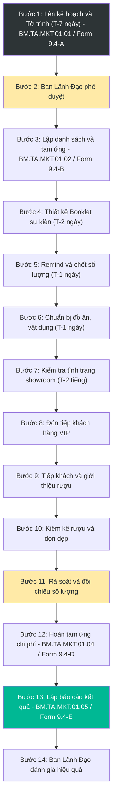
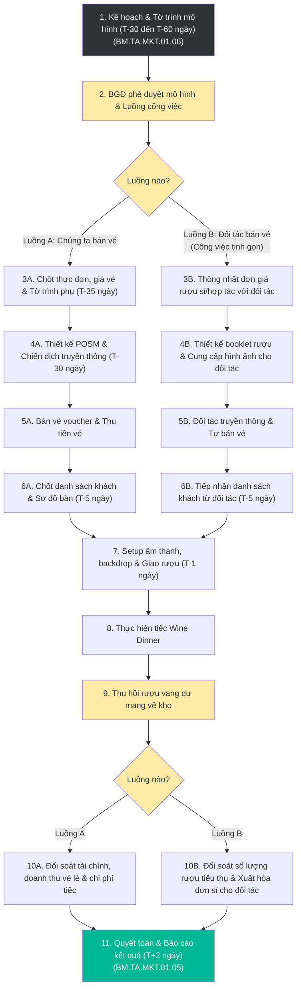

# 9.4 Tổ chức Wine Tasting & Wine Dinner Event

## 1. Mục đích & Tài liệu tham chiếu
- **Mục đích:** Chuẩn hóa hoạt động chuẩn bị, tổ chức và đối soát sau sự kiện Wine Tasting (nếm thử rượu) và Wine Dinner (tiệc tối kết hợp rượu vang) của Lyscellar. Đảm bảo tính chuyên nghiệp trong khâu tiếp đón đối tác và khách hàng, phối hợp chặt chẽ giữa các bộ phận (Marketing, Sales, Showroom, Mua hàng, Kế toán) và tối ưu hóa ngân sách sự kiện.
- **Tài liệu tham chiếu:** Căn cứ quy chế và quy trình chuẩn trong văn bản nội bộ **QD.TA.MKT.01** (*Quy định tổ chức Wine Tasting và Wine Dinner* thuộc Công ty Cổ phần Thương mại Thắng Ân).

## 2. Các loại Sự kiện & Phân loại

| Loại sự kiện | Quy mô | Đối tượng khách hàng | Tần suất | Mục tiêu cốt lõi |
| :--- | :---: | :--- | :---: | :--- |
| **Wine Tasting đón Nhà cung cấp (Supplier)** | 10-30 người | Đại diện hãng, Sommelier, HoReCa, Báo chí | Theo lịch của NCC | Giới thiệu nhà rượu, xây dựng uy tín thương hiệu, listing sản phẩm mới. |
| **Wine Tasting đón Khách hàng cá nhân (Private)** | 5-10 người | Khách hàng VIP, Khách hàng tiềm năng lớn | Theo yêu cầu | Chăm sóc khách hàng VIP, chốt doanh số trực tiếp. |
| **Wine Dinner (Tiệc tối rượu vang)** | 15-50 người | Khách VIP, Đối tác lớn, KOLs, Wine Lovers | Hàng quý / Theo dịp | Kết hợp ẩm thực cao cấp, bán voucher vé tham dự, quảng bá sản phẩm premium. |

---

## 3. Quy trình Chi tiết Tổ chức Sự kiện

### 3.1 Quy trình Wine Tasting đón Nhà cung cấp (Supplier Tasting)

```mermaid
flowchart TD
    MKT_SUP_1["Bước 1: Lên kế hoạch và Tờ trình (T-30 đến T-60 ngày) - BM.TA.MKT.01.01 / Form 9.4-A"] --> MKT_SUP_2["Bước 2: Ban Lãnh Đạo phê duyệt"]
    MKT_SUP_2 --> MKT_SUP_3["Bước 3: Lập danh sách và tạm ứng - BM.TA.MKT.01.02 / Form 9.4-B"]
    MKT_SUP_3 --> MKT_SUP_4["Bước 4: Thiết kế ấn phẩm truyền thông (T-10 ngày)"]
    MKT_SUP_4 --> MKT_SUP_5["Bước 5: Lên danh sách và mời khách (T-10 ngày)"]
    MKT_SUP_5 --> MKT_SUP_6["Bước 6: Remind khách và chốt số lượng (T-3 ngày)"]
    MKT_SUP_6 --> MKT_SUP_7["Bước 7: Chuẩn bị đồ ăn, vật dụng (T-3 tiếng)"]
    MKT_SUP_7 --> MKT_SUP_8["Bước 8: Kiểm tra tình trạng showroom (T-2 tiếng)"]
    MKT_SUP_8 --> MKT_SUP_9["Bước 9: Đón tiếp Supplier"]
    MKT_SUP_9 --> MKT_SUP_10["Bước 10: Đón tiếp khách mời"]
    MKT_SUP_10 --> MKT_SUP_11["Bước 11: Tiếp khách và chụp ảnh tư liệu"]
    MKT_SUP_11 --> MKT_SUP_12["Bước 12: Trực bàn, kiểm kê, dọn dẹp"]
    MKT_SUP_12 --> MKT_SUP_13["Bước 13: Rà soát và đối soát số lượng khui"]
    MKT_SUP_13 --> MKT_SUP_14["Bước 14: Gửi email NCC share chi phí - BM.TA.MKT.01.03 / Form 9.4-C"]
    MKT_SUP_14 --> MKT_SUP_15["Bước 15: Lập tờ trình hoàn tạm ứng - BM.TA.MKT.01.04 / Form 9.4-D"]
    MKT_SUP_15 --> MKT_SUP_16["Bước 16: Lập báo cáo kết quả - BM.TA.MKT.01.05 / Form 9.4-E"]
    MKT_SUP_16 --> MKT_SUP_17["Bước 17: Ban Lãnh Đạo đánh giá hiệu quả"]
    MKT_SUP_17 --> MKT_SUP_18["Bước 18: Họp nội bộ rút kinh nghiệm"]

    style MKT_SUP_1 fill:#2d3436,color:#fff
    style MKT_SUP_2 fill:#ffeaa7,color:#2d3436
    style MKT_SUP_7 fill:#ffeaa7,color:#2d3436
    style MKT_SUP_13 fill:#ffeaa7,color:#2d3436
    style MKT_SUP_16 fill:#00b894,color:#fff
```

#### A. Giai đoạn chuẩn bị (T-30 đến T-60 ngày đến T-1 ngày)
* **T-30 đến T-60 ngày (30-60 ngày trước): Lên kế hoạch & Viết tờ trình**
  * Marketing phối hợp với bộ phận Mua hàng nước ngoài (Foreign Procurement) làm việc với nhà cung cấp (Supplier) lấy lịch trình và thông tin dòng rượu.
  * Marketing lập **Tờ trình đề xuất tổ chức (Form 9.4-A)** trình Ban Giám gốc (BGĐ) duyệt: ghi rõ thời gian, địa điểm, ngân sách dự kiến, và danh sách sản phẩm.
  * Sau khi được duyệt, chuyển tờ trình cho Kế toán để chuẩn bị lưu hồ sơ và làm thủ tục tạm ứng chi phí (nếu có - theo **Form 9.4-B**).
* **T-10 ngày: Chuẩn bị ấn phẩm truyền thông & POSM sự kiện**
  * Marketing chịu trách nhiệm thiết kế và chuẩn bị toàn bộ ấn phẩm, POSM cho sự kiện bao gồm: thư mời (invitation), booklet giới thiệu rượu (bắt buộc thông tin mô tả hương vị/tasting notes phải đi kèm niên vụ - Vintage cụ thể của chai rượu được phục vụ), menu ẩm thực ghép đôi (pairing menu), name cards và tent cards đặt bàn.
  * Đối với các sự kiện tasting thử nếm rượu mới chuẩn bị nhập khẩu, bộ phận Mua hàng nước ngoài gửi bảng giá dự kiến cho Marketing để đưa vào tài liệu.
  * Nhân viên Sales lập danh sách khách mời mục tiêu, gửi thư mời và liên hệ mời khách hàng tham dự.
* **T-3 ngày: Chốt danh sách khách mời**
  * Sales chốt danh sách khách mời tham dự và thông báo số lượng người cho bộ phận Showroom (nếu tổ chức tại Showroom) hoặc địa điểm tổ chức để chuẩn bị.
* **T-3 tiếng (Ngày diễn ra sự kiện): Chuẩn bị Showroom / Điểm diễn ra**
  * Nhân viên Showroom chuẩn bị đồ ăn nhẹ (cheese, cold cuts, hạt, bánh mì) phù hợp với số lượng khách. 
    * *Lưu ý đặc biệt:* Đối với bánh mì, thời gian cắt và chuẩn bị hoàn thành phải đúng **01 tiếng trước giờ bắt đầu sự kiện** để đảm bảo độ giòn ngon.
  * Showroom dọn dẹp vệ sinh khu trưng bày, lối ra vào, nhà vệ sinh.
  * Chuẩn bị đầy đủ vật dụng: Ly tasting chuyên dụng (đã rửa sạch và lau khô bằng khăn microfiber), xô đá, đồ khui rượu, khăn lau ly, cốc nước lọc, spittoons (xô nhổ rượu).
  * Setup rượu vào tủ mát hoặc xô đá để đạt nhiệt độ phục vụ chuẩn xác (Rượu sủi/Trắng: 8-10°C, Đỏ nhẹ: 14-16°C, Đỏ đậm: 16-18°C).
* **T-2 tiếng: Kiểm tra tổng thể**
  * Marketing kiểm tra lại toàn bộ tình trạng vệ sinh Showroom, trang trí, hệ thống âm thanh, ánh sáng, máy chiếu và các vật dụng phục vụ.

#### B. Giai đoạn thực hiện (Ngày Event)
* **Đón tiếp:** Mua hàng nước ngoài & Marketing chịu trách nhiệm đón tiếp đại diện nhà cung cấp (Supplier). Nhân viên Showroom đón tiếp khách hàng và hướng dẫn chỗ ngồi.
* **Tiếp khách & Thử nếm:** Sales giới thiệu sản phẩm và giao lưu với khách hàng. Marketing chịu trách nhiệm chụp ảnh, quay phim lấy tư liệu truyền thông xuyên suốt sự kiện.
* **Trực bàn & Thu dọn:** Nhân viên Showroom trực bàn rượu để phục vụ rót rượu thử nếm, đảm bảo không xảy ra lãng phí hoặc tự ý khui thêm rượu ngoài tờ trình. Kết thúc sự kiện, Showroom thu dọn, rửa ly, cất vật dụng và dọn dẹp sạch sẽ.

#### C. Giai đoạn đối soát & Báo cáo (T+1 ngày đến T+2 ngày)
* **T+1 ngày: Đối soát rượu và hoàn tạm ứng**
  * Nhân viên Showroom kiểm kê số lượng chai rượu thực tế đã khui, đối chiếu và bàn giao số liệu cho Kế toán.
  * > [!WARNING]
  * > **Kiểm soát chi phí rượu Tasting:**
  * > Nếu phát sinh rượu khui ngoài phạm vi tờ trình đã duyệt, Sales phụ trách phải giải trình trực tiếp lý do bằng văn bản. Nếu lý do hợp lý, tiến hành ký duyệt bổ sung tờ trình. Trường hợp lý do không được chấp thuận, chi phí rượu phát sinh ngoài định mức sẽ **khấu trừ trực tiếp vào lương** của Sales phụ trách.
  * Mua hàng nước ngoài gửi email cho đối tác/NCC về các chi phí phối hợp chia sẻ tổ chức (nếu có - theo **Form 9.4-C**).
  * Marketing làm thủ tục hoàn tạm ứng chi phí sự kiện với Kế toán (theo **Form 9.4-D**).
* **T+2 ngày: Báo cáo hiệu quả**
  * Marketing phối hợp Sales lập Báo cáo kết quả sự kiện (theo **Form 9.4-E**): ghi nhận số lượng khách thực tế tham dự, phản hồi của khách hàng về rượu, các cơ hội kinh doanh/đơn hàng chốt tại chỗ và đánh giá hiệu quả chi phí.

---

### 3.2 Quy trình Wine Tasting đón Khách hàng cá nhân (Private Tasting)

#### A. Giai đoạn chuẩn bị (T-7 ngày đến T-1 ngày)
* **T-7 ngày (Trước 1 tuần): Lên kế hoạch & Tờ trình**
  * Sales làm việc trực tiếp với khách hàng cá nhân (khách VIP/đối tác lớn), thống nhất thời gian và nhu cầu rượu.
  * Sales lập tờ trình đề xuất tổ chức gửi BGĐ duyệt (thời gian, danh sách rượu, chi phí đồ ăn kèm).
* **T-2 ngày: Thiết kế booklet sự kiện**
  * Sales cung cấp thông tin khách hàng và danh sách dòng rượu thử nếm cho Marketing để thiết kế booklet riêng biệt cho buổi tasting của khách hàng.
* **T-1 ngày: Chốt khách & Chuẩn bị**
  * Sales liên hệ xác nhận lại thời gian chính xác với khách hàng, thông báo số lượng người tham gia cho Showroom.
  * Showroom chuẩn bị đồ ăn nhẹ, dọn dẹp vệ sinh và chuẩn bị ly, tủ bảo quản lạnh cho rượu tasting trước 1 ngày.

#### B. Giai đoạn thực hiện (Ngày Event)
* Showroom đón tiếp khách hàng. Sales trực tiếp dẫn dắt buổi thử nếm, rót rượu và giới thiệu chi tiết câu chuyện sản phẩm cho khách.
* Showroom kiểm kê lượng rượu đã dùng và thu dọn ngay sau khi kết thúc buổi tasting.

#### C. Giai đoạn đối soát & Báo cáo (T+1 ngày)
* **T+1 ngày: Đối soát và báo cáo**
  * Kế toán rà soát số lượng rượu thực tế đã khui đối chiếu với tờ trình (áp dụng quy chế phạt khấu trừ lương Sales nếu khui thừa không có lý do chính đáng).
  * Sales lập báo cáo hiệu quả buổi tasting (cơ hội chốt đơn hàng, phản hồi của khách). Marketing hoàn tạm ứng chi phí.

---

### 3.3 Quy trình Wine Dinner (Phối hợp với nhà hàng đối tác)

#### A. Giai đoạn chuẩn bị (T-30 đến T-60 ngày đến T-1 ngày)

* **T-30 đến T-60 ngày: Lên kế hoạch & Xác định mô hình**
  * Mua hàng nước ngoài thống nhất lịch trình của Supplier/Winemaker. Marketing lên kế hoạch tổ chức Wine Dinner và lập tờ trình đề xuất gửi BGĐ duyệt (Form 9.4-A / BM.TA.MKT.01.06).
  * **Phân tách luồng công việc theo phương thức bán vé:**
    - **Luồng A (Chúng ta bán vé):** áp dụng khi Lyscellar chủ trì bán voucher sỉ/lẻ, trực tiếp kiểm soát doanh thu vé.
    - **Luồng B (Đối tác bán vé):** áp dụng khi nhà hàng/đối tác tự bán vé và tự thu tiền. Công việc của Lyscellar sẽ tinh gọn hơn rất nhiều.

##### Phân nhánh Luồng A: Lyscellar bán vé
* **T-35 ngày (Trước 5 tuần): Chốt giá voucher & Thực đơn**
  * Marketing cùng nhà hàng thống nhất pairing menu, chi phí đồ ăn và danh mục rượu vang phục vụ.
  * Marketing tính toán chi phí, đề xuất giá bán voucher (vé tham dự) và trình ký tờ trình bổ sung (BM.TA.MKT.01.07) gửi BGĐ duyệt.
* **T-30 ngày đến T-7 ngày: Truyền thông & Bán vé**
  * Marketing thiết kế toàn bộ POSM (thiệp mời, pairing menu in ấn, backdrop, tent card, booklet).
  * Đội ngũ Sales kết hợp Marketing đẩy mạnh truyền thông bán voucher và trực tiếp thu tiền vé từ khách hàng (chỉ tiêu bán vé đạt từ 85% trở lên là KPI chung của cả bộ phận Marketing và Sales).
* **T-5 ngày: Chốt khách mời**
  * Sales chốt danh sách khách mua voucher, lập sơ đồ bàn tiệc và gửi phía nhà hàng chuẩn bị setup bàn tiệc.

##### Phân nhánh Luồng B: Đối tác bán vé (Tinh gọn)
* **T-35 ngày: Thống nhất đơn giá rượu hợp tác**
  * Marketing phối hợp Sales làm việc với đối tác để chốt pairing menu và thống nhất đơn giá rượu bán sỉ/giá ưu đãi hợp tác bán cho đối tác phục vụ tiệc. Không cần làm tờ trình duyệt giá vé lẻ hay dự kiến doanh thu vé lẻ.
* **T-30 ngày đến T-7 ngày: Hỗ trợ tài liệu**
  * Đối tác chịu trách nhiệm truyền thông, quảng bá và bán vé trên kênh của họ.
  * Lyscellar chỉ hỗ trợ cung cấp hình ảnh chai rượu chất lượng cao, thông tin kỹ thuật (tasting notes - bắt buộc đi kèm niên vụ cụ thể) cho đối tác truyền thông, và thiết kế booklet giới thiệu rượu vang (bắt buộc đi kèm niên vụ cụ thể) đặt tại bàn tiệc.
* **T-5 ngày: Nhận danh sách bàn**
  * Sales tiếp nhận danh sách khách mời và sơ đồ bàn tiệc do đối tác gửi sang để phục vụ cho việc chuẩn bị đón tiếp.

##### Chung cho cả 2 luồng: T-1 ngày: Setup & Bàn giao rượu
* Marketing chuẩn bị rượu vang phục vụ, POSM, backdrop mang sang nhà hàng phối hợp setup.

#### B. Giai đoạn thực hiện (Ngày Event)
* Đón tiếp Winemaker/Supplier và khách mời. Rót rượu vang phục vụ theo đúng thứ tự menu tiệc.
* Kết thúc tiệc, Sales kiểm kê số lượng rượu đã dùng và **thu hồi toàn bộ số chai rượu còn dư** (chưa khui) mang về kho của công ty.

#### C. Giai đoạn đối soát & Báo cáo (T+1 ngày)
* **Luồng A (Chúng ta bán vé):** Kế toán đối soát doanh thu vé voucher thực tế thu được, chi phí ăn uống thanh toán với nhà hàng và chi phí rượu tiêu thụ.
* **Luồng B (Đối tác bán vé - Tinh gọn):** Kế toán chỉ đối soát số lượng rượu thực tế đã khui tiêu thụ tại tiệc với đối tác theo đơn giá sỉ/hợp tác đã thỏa thuận, xuất hóa đơn sỉ trực tiếp cho đối tác thanh toán. Không cần đối soát doanh thu vé lẻ.
* **Chung:** Marketing và Sales lập báo cáo đánh giá hiệu quả sự kiện Wine Dinner (doanh thu bán voucher/bán sỉ rượu, cơ hội kinh doanh sau tiệc, chi phí thực tế vs ngân sách duyệt - BM.TA.MKT.01.05).

---

## 4. Biểu mẫu Thực hành (Forms)
- 📥 **Form 9.4-A (Tờ trình đề xuất tổ chức Sự kiện):**
  - Xem mẫu đề xuất Wine Tasting: [BM.TA.MKT.01.01](templates/BM_TA_MKT_01_01.md)
  - Xem mẫu đề xuất Wine Dinner: [BM.TA.MKT.01.06](templates/BM_TA_MKT_01_06.md)
- 📥 **Form 9.4-B (Danh sách tạm ứng chi phí sự kiện):** [BM.TA.MKT.01.02](templates/BM_TA_MKT_01_02.md)
- 📥 **Form 9.4-C (Bảng đối soát chi phí gửi Nhà cung cấp/Đối tác):** [BM.TA.MKT.01.03](templates/BM_TA_MKT_01_03.md)
- 📥 **Form 9.4-D (Tờ trình quyết toán và hoàn tạm ứng chi phí):** [BM.TA.MKT.01.04](templates/BM_TA_MKT_01_04.md)
- 📥 **Form 9.4-E (Báo cáo kết quả và hiệu quả sự kiện):** [BM.TA.MKT.01.05](templates/BM_TA_MKT_01_05.md)
- 📥 **Tờ trình bổ sung chốt thực đơn & giá voucher Wine Dinner:** [BM.TA.MKT.01.07](templates/BM_TA_MKT_01_07.md)

---

## 5. Các Chỉ số Đo lường KPI

| Chỉ số KPI | Phương pháp tính | Mục tiêu tối thiểu | Tần suất đo |
| :--- | :--- | :---: | :---: |
| **Tỷ lệ khách tham dự** | (Số khách thực tế tham dự / Số khách nhận lời mời) | **≥ 80%** | Theo từng sự kiện |
| **Tỷ lệ phát sinh đơn hàng** | (Số khách chốt đơn mua hàng sau event / Tổng số khách tham dự) | **≥ 30%** | Trong vòng 7 ngày sau event |
| **Tỷ lệ bán vé Wine Dinner (Luồng A)** | (Số vé thực tế bán được / Tổng số vé mở bán theo kế hoạch) | **≥ 85%** | Theo từng sự kiện (KPI Marketing & Sales) |
| **Tỷ lệ hoàn thành báo cáo** | Thời gian nộp báo cáo kết quả & hoàn tạm ứng sau sự kiện | **T+1 đến T+2 ngày** | Theo từng sự kiện |
| **Hiệu suất ngân sách** | (Chi phí thực tế / Ngân sách dự kiến được duyệt) | **≤ 100%** | Theo từng sự kiện |

---

## 6. Phụ lục: Quy chế Xử phạt Chậm trễ Tiến độ Sự kiện
Để đảm bảo tiến độ chuẩn bị sự kiện diễn ra suôn sẻ, không làm gián đoạn công việc phối hợp liên bộ phận và ảnh hưởng đến trải nghiệm của đối tác/khách hàng, công ty áp dụng quy chế kỷ luật hành chính như sau:

| Mức độ chậm trễ | Mô tả hành vi vi phạm | Hình thức xử lý áp dụng |
| :--- | :--- | :--- |
| **Dưới 30 phút** | Trễ hạn nộp tờ trình, chậm chuẩn bị showroom/vật dụng nhưng chưa gây hậu quả nghiêm trọng. | Nhắc nhở lần 1 + Cảnh báo nội bộ bằng văn bản. |
| **Từ 30 đến 60 phút** | Chậm trễ ảnh hưởng trực tiếp đến công việc của bộ phận khác (ví dụ: Marketing chậm gửi thiết kế làm Sales không gửi được thư mời...). | Cảnh báo lần 2 + **Khấu trừ 50% ngày lương** của ngày xảy ra vi phạm. |
| **Trên 60 phút** | Chậm trễ nghiêm trọng làm gián đoạn công việc, gây ảnh hưởng xấu đến tiến trình sự kiện hoặc trải nghiệm của Supplier/Khách hàng. | Cảnh báo cấp quản lý + **Khấu trừ 01 ngày lương** của ngày vi phạm. |
| **Không thực hiện** | Cố tình trì hoãn hoặc bỏ qua nhiệm vụ đã được phân công và nhắc nhở. | Cảnh báo cấp quản lý + **Khấu trừ 02 ngày lương**. |
| **Vi phạm từ 03 lần trở lên/tháng** | Lặp lại hành vi chậm trễ vô kỷ luật nhiều lần trong tháng. | Đưa ra Hội đồng kỷ luật xem xét tạm đình chỉ công việc hoặc **chấm dứt hợp đồng lao động**. |

---

## 7. Tài liệu Liên quan
- ↔ [6.3 Xử lý Đơn hàng Bán](../06_ban_hang/6.3_xu_ly_don_hang.md) | [6.10 Quy trình Xuất rượu Mẫu thử & Tasting](../06_ban_hang/6.10_xuat_ruou_mau_thu_tasting.md)
- ↔ [8.10 Quản lý Chi phí Tasting & Tiếp khách](../08_tai_chinh/8.10_quan_ly_chi_phi_tasting_tiep_khach.md)
- ↔ [Kiến thức: Nhận diện Lỗi rượu vang](../../concepts/concept_loi_chat_luong_ruou_vang.md)
