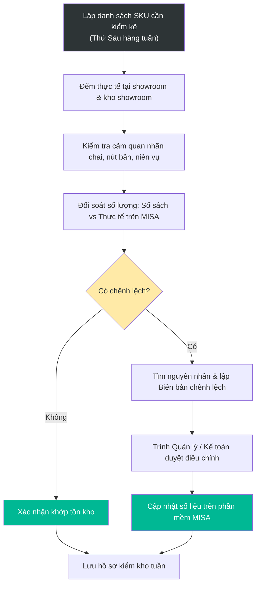
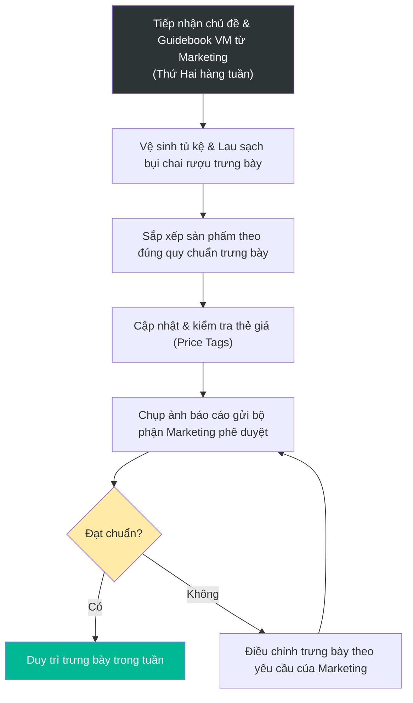

# 12.4 Quy trình Kiểm kho Hàng tuần & Đảo VM Showroom

## 1. Mục đích & Phạm vi
- **Mục đích:** 
  1. Đảm bảo tính chính xác và kịp thời của số liệu tồn kho showroom và các mã hàng bán chạy (fast-moving) thông qua kiểm kê nhanh định kỳ hàng tuần, phát hiện sớm các chênh lệch để đối soát kịp thời.
  2. Duy trì diện mạo showroom luôn mới mẻ, chuyên nghiệp và đúng tiêu chuẩn trưng bày thương hiệu (Visual Merchandising - VM) của Lyscellar nhằm thu hút khách hàng và đẩy mạnh doanh số theo chủ đề truyền thông từng tuần/tháng.
- **Phạm vi áp dụng:** Áp dụng tại toàn bộ hệ thống Showroom của Lyscellar và các bộ phận liên quan (Showroom, Sales, Marketing, Kế toán).

---

## 2. Quy trình Kiểm kho Showroom Hàng tuần (Weekly Stock Check)

### 2.1 Sơ đồ Quy trình Kiểm kho

### 2.2 Các bước thực hiện
- **Tần suất:** Thực hiện vào **Thứ Sáu hàng tuần** (hoàn tất trước 17:00).
- **Các bước chi tiết:**
  1. **Lập danh sách kiểm kê:** Kế toán kho hoặc nhân viên Showroom trích xuất danh sách tồn kho trên phần mềm MISA tại Kho Showroom (`KSR`), tập trung vào các SKU có phát sinh giao dịch trong tuần hoặc hàng fast-moving bán chạy.
  2. **Đếm thực tế:** Nhân viên Showroom tiến hành đếm kiểm thực tế toàn bộ chai rượu trưng bày trên kệ và trong tủ trữ tại Showroom.
  3. **Kiểm tra chất lượng cảm quan (Quality & Aging Check):**
     - Đảm bảo các chai rượu sạch sẽ, không bám bụi bẩn.
     - Kiểm tra tình trạng nút bần: Không rò rỉ rượu, không đẩy nút (lồi nút), không nứt vỡ màng co.
     - Kiểm tra tình trạng nhãn mác: Không rách, nhăn, ẩm mốc, mờ thông tin. Đảm bảo dán đầy đủ nhãn phụ tiếng Việt và tem rượu nhập khẩu.
     - Đối chiếu niên vụ (Vintage) trên nhãn chai thực tế so với niên vụ được ghi nhận trên phần mềm để tránh xuất nhầm niên vụ.
  4. **Đối soát số liệu:** So sánh số liệu đếm thực tế với số liệu trên phần mềm MISA.
  5. **Xử lý chênh lệch:** 
     - Nếu phát hiện chênh lệch (thừa/thiếu), nhân viên đếm lại lần 2.
     - Rà soát các chứng từ xuất/nhập trong tuần (đơn hàng lẻ tại quầy chưa ghi nhận, chai làm mẫu thử/tasting chưa làm phiếu xuất, hàng vỡ/hỏng chưa làm tờ trình khấu hao).
     - Ghi nhận chênh lệch vào **Biên bản kiểm kho tuần (Form 12.4-A)** và trình Quản lý Showroom / Kế toán kho duyệt phương án xử lý trước khi cập nhật dữ liệu.

---

## 3. Quy trình Đảo VM Showroom Hàng tuần (Showroom VM Rotation)

### 3.1 Sơ đồ Quy trình Đảo VM

### 3.2 Các bước thực hiện
- **Tần suất:** Thực hiện vào **Thứ Hai hàng tuần** (hoàn tất trước 11:00 để sẵn sàng đón khách).
- **Các bước chi tiết:**
  1. **Xác định chủ đề (Theme Setup):** Bộ phận Marketing gửi kế hoạch truyền thông và chủ đề trưng bày của tuần/tháng (ví dụ: Rượu vang chào hè, Quà tặng Trung Thu, Vang đỏ thượng hạng, Bộ sưu tập vang Ý...) kèm theo hướng dẫn bài trí chi tiết (planogram).
  2. **Vệ sinh quầy kệ và chai trưng bày:** Lau dọn kệ gỗ, mặt kính trưng bày. Lau sạch bụi bám trên chai rượu, đặc biệt là phần cổ và vai chai.
  3. **Đảo vị trí và sắp đặt trưng bày (VM Rotation):**
     - Đưa các dòng rượu thuộc chiến dịch tiêu điểm của tuần lên kệ trung tâm hoặc vị trí ngang tầm mắt (Eye Level - vị trí bán hàng tốt nhất).
     - Trưng bày theo cụm sản phẩm có liên quan (theo quốc gia, nhà rượu, hoặc phân khúc giá từ thấp đến cao từ trái qua phải).
     - Tuân thủ nguyên tắc thẩm mỹ: Mặt nhãn chính hướng thẳng ra ngoài, chai xếp thẳng hàng, không để khoảng trống lớn trên kệ trưng bày.
     - Khu vực bàn đảo trung tâm (Center Table) phải setup đúng concept, kết hợp thêm POSM hoặc phụ kiện đi kèm (ly pha lê, khui rượu, hộp quà, hoa trang trí).
  4. **Kiểm tra nhãn giá (Price Tag Check):** Đảm bảo tất cả chai rượu trưng bày đều có nhãn giá (Price tag) đi kèm rõ ràng. Nhãn giá phải ghi đúng giá bán niêm yết hiện hành, không bị rách, mờ hoặc lệch thông tin sản phẩm.
  5. **Chụp ảnh báo cáo và duyệt:** Nhân viên showroom chụp ảnh toàn cảnh showroom và các khu vực tiêu điểm sau khi đảo VM gửi lên nhóm chat chung của bộ phận. Đại diện Marketing kiểm tra hình ảnh trưng bày thực tế, yêu cầu điều chỉnh nếu chưa đạt chuẩn thẩm mỹ thương hiệu.

---

## 4. Phân công Trách nhiệm (RACI Matrix)

| Đầu việc | Nhân viên Showroom | Quản lý Showroom | Kế toán Kho | Bộ phận Marketing | Ban Giám đốc (BGĐ) |
| :--- | :---: | :---: | :---: | :---: | :---: |
| **Kiểm kho hàng tuần** | **R** (Thực hiện đếm) | **A** (Kiểm tra & Duyệt) | **C** (Đối soát hệ thống) | — | **I** |
| **Xử lý chênh lệch tồn kho**| **R** (Truy vết) | **A** (Duyệt biên bản) | **R** (Cập nhật MISA) | — | **I** (Nếu chênh lệch lớn) |
| **Lên Guidebook/Chủ đề VM**| — | **C** | — | **R** (Thiết kế & Gửi) | **A** (Duyệt chủ đề) |
| **Thực hiện đảo VM showroom**| **R** (Setup trưng bày) | **A** (Giám sát) | — | **C** (Hướng dẫn) | — |
| **Phê duyệt hình ảnh VM** | — | **C** | — | **R** (Đánh giá & Duyệt) | **I** |

---

## 5. Biểu mẫu Thực hành
- 📥 **Form 12.4-A (Biên bản kiểm kho showroom hàng tuần):** Biểu mẫu Excel ghi nhận chênh lệch số lượng đếm, mô tả tình trạng cảm quan chất lượng (nứt vỡ, mốc nhãn) và giải trình nguyên nhân.
- 📥 **Guidebook VM tuần:** Tài liệu hình ảnh hướng dẫn bố cục trưng bày sản phẩm do Marketing cung cấp.

---

## 6. Chỉ số Đo lường KPI
1. **Tỷ lệ chính xác tồn kho tuần:** Số lượng SKU khớp thực tế / Tổng số SKU kiểm kho $\ge$ **99.5%**.
2. **Thời gian hoàn thành đảo VM:** Hoàn tất trước **11:00 Thứ Hai hàng tuần** (Đạt/Không đạt).
3. **Tỷ lệ nhãn giá chính xác:** 100% chai rượu trưng bày có thẻ giá đúng giá niêm yết hiện tại.
4. **Thời gian phê duyệt hình ảnh VM:** Marketing phản hồi duyệt hình ảnh showroom trong vòng **30 phút** kể từ khi showroom gửi ảnh báo cáo.

---

## 7. Tài liệu Liên quan
- ↔ [5.4 Quản lý Tồn kho](../05_kho_van/5.4_quan_ly_ton_kho.md) | [5.5 Kiểm kê Hàng hóa](../05_kho_van/5.5_kiem_ke.md)
- ↔ [12.1 Checklist Vận hành Hàng ngày](12.1_checklist_hang_ngay.md) | [12.2 Hướng dẫn Phân công Bộ phận](12.2_huong_dan_phan_cong.md)
- ↔ [9.2 Quy trình Phê duyệt Ngân sách Marketing & POSM Khách hàng](../09_marketing/9.2_quy_trinh_duyet_ngan_sach_mkt_posm.md)
